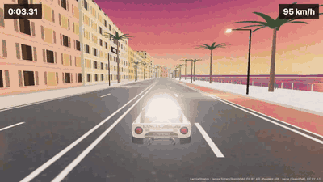
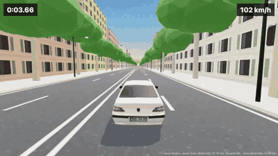

# Stratos Engine

Le moteur du jeu **Stratos**, le sprint sur la Promenade des Anglais qu'on joue sur [codebreak.fr](https://codebreak.fr). Une route construite le long d'une courbe, une physique arcade, trois décors, une voiture chargée en glTF : tout en [three.js](https://threejs.org), dans le navigateur, sans build obligatoire.

| Promenade des Anglais, en Lancia Stratos | Avenue du Prado, en Peugeot 406 |
|---|---|
|  |  |

## Essayer

```bash
git clone https://github.com/sambeauprak/stratos-engine
cd stratos-engine && npm install && npm run dev
```

Flèches ou ZQSD pour conduire, Espace pour freiner, C pour changer de caméra, P pour la pause, R pour recommencer. Manette et écran tactile aussi (`game.setTouch`).

## L'utiliser dans ton jeu

```bash
npm install three github:sambeauprak/stratos-engine
```

```html
<div id="stage" style="position: fixed; inset: 0"><canvas id="scene"></canvas></div>
<script type="module" src="./main.js"></script>
```

```js
import { createGame } from 'stratos-engine'

const game = await createGame({
  canvas: document.getElementById('scene'),
  decorId: 'coucher',
  onHud: (hud) => console.log(hud.kmh, 'km/h'),
  onState: (state, payload) => console.log(state, payload)
})
game.start()
```

Le canvas prend la taille de son parent. Le moteur ne charge three.js qu'à l'import : avec un `import()` dynamique, ta page reste légère tant qu'on ne joue pas.

### Les options de `createGame`

| Option | Ce qu'elle fait |
|---|---|
| `canvas` | Le `<canvas>` à dessiner. |
| `decorId` | `'soleil'`, `'coucher'` ou `'nuit'` (`DECORS` dans `decors.js`, chacun n'est que des réglages de ciel, de soleil et de brouillard). |
| `track` | Le tracé : `{ points: [[x, z], …], limits: { min, max }, start, endMargin }`, en mètres. `PROMENADE` (défaut) et `PRADO` sont fournis. |
| `car` | `'stratos'` (défaut), ou `{ url, wheelbase, wheels }` pour n'importe quel `.glb` dont les quatre roues sont des objets nommés (`PEUGEOT_406` est fourni). |
| `scenery` | `'promenade'` (défaut), `'boulevard'`, ou ta fonction `({ path, decor, sunDir, anisotropy }) → { group, update(time, camera) }`. |
| `finishLine` | `true` : la course s'arrête à la fin du tracé et garde le meilleur temps par décor (localStorage). `false` pour un jeu libre. |
| `onProgress` | Le chargement de la voiture, de 0 à 1. |
| `onHud` | Les cadrans, une quinzaine de fois par seconde : `{ kmh, gear, rpm, time, best, progress, remaining, camera, bikeLane }`. |
| `onState` | `'intro'`, `'countdown'` (3, 2, 1), `'race'`, `'paused'`, `'finish'` (`{ time, best, previous, record }`). |
| `onReady` | `({ scene, car, sim, path })` quand la scène est construite : pour y ajouter tes objets. |
| `onStep` | `(dt)` à chaque image pendant la course : ta logique de jeu. `sim` donne `x, z, heading, speed, s, u, touching`. |
| `pilot` | `(sim, path) → { steer, throttle, brake }` : conduit à la place du joueur (démo, tournage, tests). |

`game` renvoie `start()`, `restart()`, `togglePause()`, `cycleCamera()`, `setTouch(name, bool)` et `dispose()`.

### Le tracé

`buildPath` échantillonne la courbe (Catmull-Rom) tous les mètres ; chaque échantillon a sa position, sa tangente, sa normale et son cap. `pointAt(path, s, u)` donne un point à `s` mètres du départ et `u` mètres à droite de l'axe ; `project(path, x, z)` fait l'inverse. Tout le reste, la route, le décor, la physique, lit ces échantillons.

```js
import { createGame, pointAt, THREE } from 'stratos-engine'

const game = await createGame({
  canvas,
  decorId: 'soleil',
  track: { points: [[0, -160], [0, 0], [0, 500], [30, 900]], limits: { min: -7.05, max: 7.05 } },
  scenery: 'boulevard',
  finishLine: false,
  onReady: ({ scene, path }) => {
    const [x, z] = pointAt(path, 300, -10)
    const cube = new THREE.Mesh(new THREE.BoxGeometry(2, 2, 2), new THREE.MeshStandardMaterial({ color: '#ffc21a' }))
    cube.position.set(x, 1, z)
    scene.add(cube)
  }
})
```

### La physique

Arcade, calée sur la Stratos : environ 5 s de 0 à 100 km/h, 230 km/h en pointe, un modèle « bicyclette » pour la direction, et un braquage qui se réduit avec la vitesse (sinon on tourne sur place à 200 km/h). Les bordures renvoient sur la route en coûtant de la vitesse selon l'angle du choc. Les réglages sont dans `CAR`, en tête de `src/game.js`.

## Les modèles 3D

Les deux voitures sont sous licence **CC BY 4.0** et leurs auteurs doivent être crédités à l'écran : voir [models/LICENSES.md](models/LICENSES.md).

## Licence

Le code est sous licence MIT. Fait pour la Side Quest « Taxi à Marseille » de [CodeBreak](https://codebreak.fr/quests), où on refait Stratos en mode Driver.
